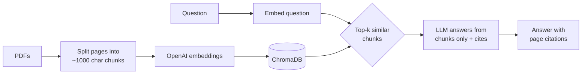

# DocuChat

Ask questions about your PDFs and get answers with page citations.

Policies, manuals and research papers bury important details in long PDFs. Keyword search misses
anything phrased differently, and a general chatbot doesn't know what's in your files, so it
guesses. DocuChat uses **retrieval-augmented generation (RAG)**: it finds the passages that
actually answer the question and makes the LLM answer only from those, citing the page it used.

  

## How it works



1. **Ingest** – each PDF is read page by page with `pypdf`, so every chunk knows its file and page number.
2. **Chunk** – pages are split into ~1000 character chunks with 150 characters of overlap so sentences on a boundary aren't lost.
3. **Embed & store** – chunks are turned into vectors with `text-embedding-3-small` and saved in a local ChromaDB collection.
4. **Retrieve** – the question is embedded and the 4 most similar chunks (cosine similarity) are fetched.
5. **Answer** – the chunks are numbered `[1]..[4]` and sent to the LLM with strict instructions: answer only from them, cite the numbers, and say *"I couldn't find that in the documents"* otherwise.
6. **Cite** – the `[n]` markers in the answer are mapped back to file + page and shown under the answer.

More detail in [docs/architecture.md](docs/architecture.md).

## Project structure

```
DocuChat/
├── app.py                  # Streamlit chat UI
├── docuchat/
│   ├── config.py           # models, chunk size, top-k (overridable via .env)
│   ├── loader.py           # PDF -> one Document per page
│   ├── store.py            # chunking + ChromaDB helpers
│   ├── ingest.py           # CLI to index PDFs
│   └── qa.py               # retrieval, prompt, citations
├── eval/
│   ├── questions.json      # 20 test questions with known answers and pages
│   └── run_eval.py         # scores the system on them
├── scripts/
│   └── download_samples.py # fetches the sample PDFs used by the eval
├── tests/                  # offline unit tests (no API key needed)
└── data/                   # put your PDFs here
```

## Setup

```bash
git clone https://github.com/<your-username>/DocuChat.git
cd DocuChat
python -m venv .venv && source .venv/bin/activate
pip install -r requirements.txt

cp .env.example .env        # then add your OpenAI API key
```

## Usage

**Web app**

```bash
streamlit run app.py
```

Upload PDFs from the sidebar, click *Index uploaded files*, then ask away.

**Command line indexing**

```bash
python scripts/download_samples.py     # optional: sample PDFs used in the eval
python -m docuchat.ingest              # index everything in data/
python -m docuchat.ingest some/file.pdf
```

Re-indexing a file replaces its old chunks, so it's safe to run more than once.

## Evaluation

`eval/questions.json` has 20 questions over two sample documents, the
[RAG paper (Lewis et al., 2020)](https://arxiv.org/abs/2005.11401) and the
[NIST AI Risk Management Framework 1.0](https://doi.org/10.6028/NIST.AI.100-1).
Each question has a reference answer and the page(s) it comes from (PDF page numbers, so
the first page of the file is page 1, not the number printed in the footer). Two questions are
deliberately **not** answerable from the documents, to check the system refuses instead of
making something up.

```bash
python scripts/download_samples.py
python -m docuchat.ingest
python -m eval.run_eval
```

It reports three numbers and writes a per-question table to `eval/results.md`:

| Metric | What it measures |
|---|---|
| Answer accuracy | Answer matches the reference (graded by an LLM judge); for unanswerable questions, the system must refuse |
| Retrieval hit rate @ k | A chunk from the correct page was among the top-k retrieved |
| Citation accuracy | The answer cited a chunk from the correct page |

Splitting the score this way shows *where* a failure happened: a retrieval miss means the
chunking/embedding side needs work, while a retrieval hit with a wrong answer points at the prompt or model.

**Results:** see [eval/results.md](eval/results.md) after running the eval.

## Tests

```bash
pip install -r requirements-dev.txt
pytest
```

The tests use fake embeddings and a fake LLM, so they run offline and for free.

## Configuration

All settings live in `.env` (see `.env.example`):

| Variable | Default |
|---|---|
| `CHAT_MODEL` | `gpt-6-luna` |
| `EMBEDDING_MODEL` | `text-embedding-3-small` |
| `CHUNK_SIZE` / `CHUNK_OVERLAP` | `1000` / `150` |
| `TOP_K` | `4` |

If you change the embedding model, delete `chroma_db/` and re-index.

## Limitations and ideas

- Scanned PDFs have no text layer, so they'd need OCR first.
- Each question is answered on its own; there's no follow-up memory yet.
- Retrieval is pure vector search. Adding keyword search (BM25) and a re-ranker would help with exact terms like IDs and acronyms.

## Further reading

- [Retrieval-Augmented Generation for Knowledge-Intensive NLP Tasks](https://arxiv.org/abs/2005.11401) – the original RAG paper
- [LangChain: build a RAG app](https://docs.langchain.com/oss/python/langchain/rag)
- [Chroma: getting started](https://docs.trychroma.com/docs/overview/getting-started)
- [OpenAI embeddings guide](https://developers.openai.com/api/docs/guides/embeddings)
- [Chunking strategies for LLM applications](https://www.pinecone.io/learn/chunking-strategies/)
